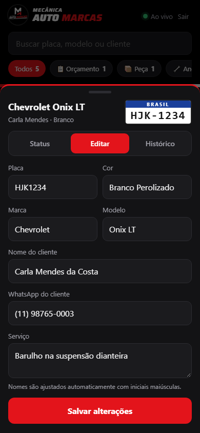
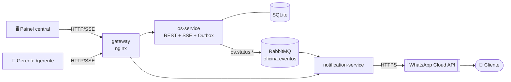

<p align="center"></p>

# Mecânica Auto Marcas · Gestão de Veículos

Controle dos serviços de veículos da **Mecânica Auto Marcas**, com **painel central em tempo real**, **app do gerente
no celular** e **aviso automático por WhatsApp** quando o carro fica pronto.


| App do gerente (celular) | Aba de edição do veículo |
|---|---|
|  |  |

## Funcionalidades

- **Painel central** (TV/monitor) com os veículos em 4 colunas: **Aguardando Orçamento**, **Aguardando Peça**,
  **Em Andamento** e **Pronto para Entrega**. Cada card mostra **placa** (padrão Mercosul), **marca e modelo**,
  cliente, serviço e há quanto tempo o carro está naquele status.
- **Atualização em tempo real** (Server-Sent Events): o que o gerente muda no celular aparece no painel na hora, com destaque visual.
- **App do gerente** (`/gerente`, PWA instalável): login por código de acesso, busca por placa, filtros,
  cadastro de entrada, troca de status, observações e registro de entrega. Ao tocar em um veículo, abas
  **Status**, **Editar** (placa, marca, modelo, cor, cliente, WhatsApp e serviço) e **Histórico**.
- **Nomes padronizados**: nomes próprios recebem iniciais maiúsculas automaticamente, no formulário e no servidor
  (`joão da silva` → `João da Silva`, `onix ltz` → `Onix LTZ`, `bmw` → `BMW`). Nome de cliente com números é recusado.
- **Identidade visual** da Mecânica Auto Marcas (preto, branco e vermelho) no painel, no app e na mensagem do WhatsApp.
- **WhatsApp automático**: ao marcar *Pronto para Entrega*, o cliente recebe uma mensagem pela
  **WhatsApp Business Cloud API** (Meta). Em desenvolvimento, o modo `mock` registra a mensagem sem enviar.
- **Microsserviços + mensageria** com RabbitMQ, Transactional Outbox, idempotência, retentativa com backoff e DLQ.

## Arquitetura



📐 **Documentação completa:**
- [docs/UML.md](docs/UML.md): casos de uso, classes, máquina de estados, sequência e implantação
- [docs/ARQUITETURA.md](docs/ARQUITETURA.md): microsserviços, mensageria, API REST, configuração do WhatsApp e segurança

## Como rodar (Docker)

Pré-requisito: Docker com Docker Compose.

```bash
git clone https://github.com/CarlosAlvesSantosJr/Gest-oDeVeiculos.git
cd Gest-oDeVeiculos
cp .env.example .env        # opcional: ajuste token do gerente, nome da oficina, WhatsApp
docker compose up -d --build
```

| O quê | Endereço |
|---|---|
| Painel central | http://localhost:8080 |
| App do gerente | http://localhost:8080/gerente (código padrão: `gerente123`) |
| RabbitMQ (admin) | http://localhost:15672 (`oficina` / `oficina123`) |
| WhatsApps enviados | http://localhost:8080/api/notificacoes |

> Se a porta 8080 estiver ocupada: `HTTP_PORT=8088 docker compose up -d` (ou defina `HTTP_PORT` no `.env`).

### Usar no celular do gerente
1. Celular na **mesma rede Wi-Fi** do computador que roda o Docker.
2. Descubra o IP do computador (`ipconfig` no Windows) e abra `http://SEU_IP:8080/gerente` no celular.
3. No navegador, use **"Adicionar à tela inicial"** para abrir como aplicativo.
4. Para usar fora da oficina, publique com HTTPS (ex.: `cloudflared tunnel --url http://localhost:8080`).

### Ativar o WhatsApp real
No `.env`, configure `WHATSAPP_PROVIDER=cloud`, `WHATSAPP_TOKEN`, `WHATSAPP_PHONE_NUMBER_ID` e, de preferência,
`WHATSAPP_TEMPLATE_NAME` com um template aprovado. O passo a passo está em [docs/ARQUITETURA.md](docs/ARQUITETURA.md#whatsapp-business-cloud-api).

## Testes

```bash
npm run install:all   # instala dependências dos dois serviços
npm test              # 71 testes unitários/integração (domínio, repositório, outbox, API, SSE, WhatsApp, consumidor)
docker compose up -d --build
npm run test:e2e      # teste ponta a ponta contra a stack no Docker (gateway → API → RabbitMQ → WhatsApp)
```

Os testes também rodam dentro do Docker (`docker build --target test services/os-service`) e no
GitHub Actions a cada push ([.github/workflows/ci.yml](.github/workflows/ci.yml)).

## Estrutura

```
├── docker-compose.yml
├── gateway/                    # nginx: API gateway + frontend estático
├── frontend/
│   ├── index.html              # painel central
│   ├── gerente/                # app mobile do gerente (PWA)
│   └── assets/                 # CSS/JS compartilhados
├── services/
│   ├── os-service/             # ordens de serviço, status, SSE, outbox → RabbitMQ
│   └── notification-service/   # consumidor RabbitMQ → WhatsApp Cloud API
├── tests/e2e/                  # teste ponta a ponta
└── docs/                       # UML e arquitetura
```

## Stack
Node.js 24 · Express · SQLite (`node:sqlite`) · RabbitMQ 3.13 · nginx · HTML/CSS/JS sem framework · Docker Compose · `node:test`
