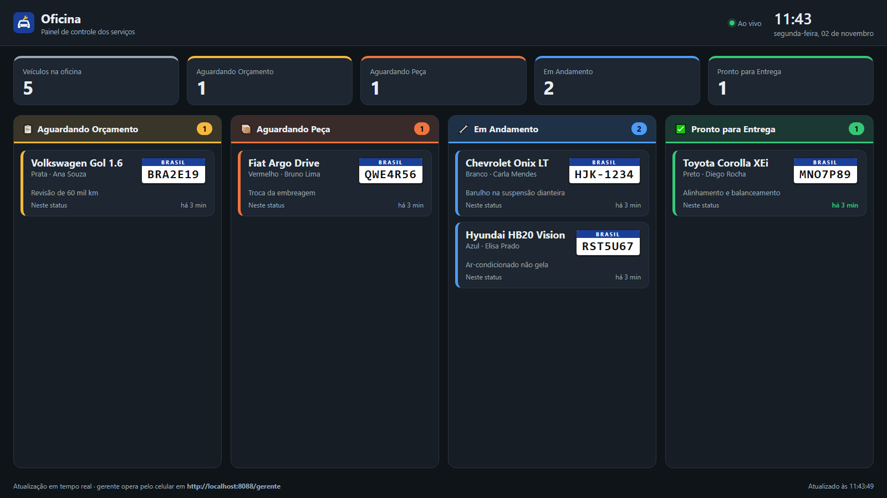
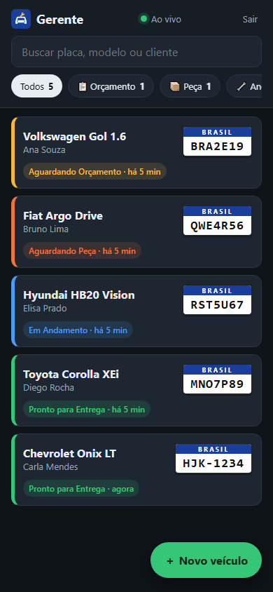
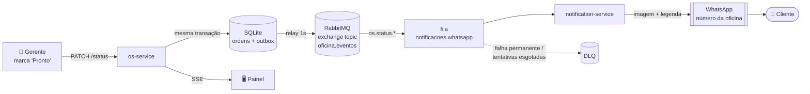

<p align="center"></p>

# Mecânica Auto Marcas · Gestão de Veículos

Sistema de controle dos serviços de veículos da **Mecânica Auto Marcas**: **painel central em tempo real** na
oficina, **app do gerente no celular** e **aviso automático por WhatsApp** ao cliente quando o carro fica pronto.



| App do gerente (celular) | Aba de edição do veículo | Imagem enviada ao cliente |
|---|---|---|
|  |  |  |

## Funcionalidades

- **Painel central** (TV/monitor) com os veículos em 4 colunas: **Aguardando Orçamento**, **Aguardando Peça**,
  **Em Andamento** e **Pronto para Entrega**. Cada card mostra **placa** (padrão Mercosul), **marca e modelo**,
  cliente, serviço e há quanto tempo o carro está naquele status.
- **Tempo real** (Server-Sent Events): o que o gerente muda no celular aparece no painel na hora, com destaque visual.
- **App do gerente** (`/gerente`, PWA instalável): login por código de acesso, busca por placa, filtros, cadastro de
  entrada, troca de status com um toque e registro de entrega. Ao tocar em um veículo: abas **Status**, **Editar**
  (placa, marca, modelo, cor, cliente, WhatsApp e serviço) e **Histórico**.
- **WhatsApp automático**: ao marcar *Pronto para Entrega*, o cliente recebe uma mensagem profissional com a
  **logo da oficina**, saindo do **número da própria oficina**. Tela de conexão do WhatsApp no app do gerente.
- **Dados padronizados**: nomes com iniciais maiúsculas (`joão da silva` → `João da Silva`, `onix ltz` → `Onix LTZ`,
  `bmw` → `BMW`) e celulares com o 9 completado automaticamente (`(48) 9876-0000` → `5548998760000`).
- **Identidade visual** da Mecânica Auto Marcas (preto, branco e vermelho) no painel, no app e na mensagem.

## Mensageria em destaque



| Garantia | Como |
|---|---|
| Nenhum evento perdido | **Transactional Outbox**: status e evento gravados na mesma transação; relay publica com *publisher confirms* |
| Funciona com o broker fora do ar | Eventos acumulam no outbox e são publicados em ordem quando o RabbitMQ volta |
| Sem WhatsApp duplicado | Entrega *at-least-once* + **idempotência** por `eventId` (persistida em SQLite) |
| Falhas temporárias | **Retentativa com backoff exponencial** (5s, 10s, 20s… cerca de 10 min) |
| Falhas definitivas | **Dead Letter Queue** (número sem WhatsApp, mensagem corrompida) |
| Desacoplamento | O gerente nunca espera o WhatsApp: a resposta do celular é imediata |
| Teste seguro | `WHATSAPP_PERMITIDOS` restringe os destinatários durante a homologação |

📐 **Documentação completa:**
- [docs/ARQUITETURA.md](docs/ARQUITETURA.md): microsserviços, mensageria, WhatsApp, API REST e segurança
- [docs/UML.md](docs/UML.md): casos de uso, classes, máquina de estados, sequência e implantação

## Como rodar (Docker)

Pré-requisito: Docker com Docker Compose.

```bash
git clone https://github.com/CarlosAlvesSantosJr/Gest-oDeVeiculos.git
cd Gest-oDeVeiculos
cp .env.example .env        # ajuste token do gerente, nome da oficina, WhatsApp
docker compose up -d --build
```

| O quê | Endereço |
|---|---|
| Painel central | http://localhost:8080 |
| App do gerente | http://localhost:8080/gerente (código padrão: `gerente123`) |
| RabbitMQ (admin) | http://localhost:15672 (`oficina` / `oficina123`) |
| WhatsApps enviados | http://localhost:8080/api/notificacoes |

> Se a porta 8080 estiver ocupada, defina `HTTP_PORT=8088` no `.env`.

### Usar no celular do gerente
1. Celular na **mesma rede Wi-Fi** do computador que roda o Docker.
2. Descubra o IP do computador (`ipconfig` → "Endereço IPv4") e abra `http://SEU_IP:8080/gerente` no celular.
3. No Windows, libere a porta no firewall (PowerShell como administrador):
   ```powershell
   New-NetFirewallRule -DisplayName "Auto Marcas - Painel" -Direction Inbound -Protocol TCP -LocalPort 8080 -RemoteAddress LocalSubnet -Action Allow -Profile Private,Public
   ```
4. No Chrome do celular, use **"Adicionar à tela inicial"** para abrir como aplicativo.
5. Fora da oficina: publique com HTTPS (ex.: `cloudflared tunnel --url http://localhost:8080`).

### Ativar o WhatsApp
**Pelo número da oficina (modo `web`):**
```env
WHATSAPP_PROVIDER=web
WHATSAPP_NUMERO_PAREAMENTO=5548999999999   # número da oficina com DDI 55
WHATSAPP_PERMITIDOS=                       # vazio = todos os clientes; preencha para homologar
SEED_DEMO=false                            # sem veículos de demonstração em produção
```
Rode `docker compose up -d`, toque em **WhatsApp** no app do gerente e, no celular da oficina, vá em
*WhatsApp → Aparelhos conectados → Conectar aparelho* e escaneie o QR code (ou use o código de pareamento).
A sessão fica salva e sobrevive a reinícios. ⚠️ Não é a API oficial: use para avisos individuais, não para envios em massa.

**Pela API oficial (modo `cloud`):** configure `WHATSAPP_PROVIDER=cloud`, `WHATSAPP_TOKEN`, `WHATSAPP_PHONE_NUMBER_ID`
e um template aprovado em `WHATSAPP_TEMPLATE_NAME` ([passo a passo](docs/ARQUITETURA.md#whatsapp-business-cloud-api)).

**Desenvolvimento (modo `mock`, padrão):** as mensagens são apenas registradas em `/api/notificacoes`.

## Testes

```bash
npm run install:all   # instala dependências dos dois serviços
npm test              # 81 testes unitários e de integração
docker compose up -d --build
npm run test:e2e      # ponta a ponta: gateway → API → RabbitMQ → notificação (BASE_URL=http://localhost:8080)
```

| Serviço | Testes | Cobertura |
|---|---|---|
| os-service | 46 | domínio (placas, telefones, nomes, transições), repositório, outbox, API REST, SSE, normalização |
| notification-service | 35 | mensagens, provedores WhatsApp (mock, Cloud API, web), idempotência, lista de permitidos, retentativa/DLQ, API |
| E2E | 2 | frontend servido pelo gateway, redirecionamentos e fluxo completo com edição e notificação |

Os testes também rodam dentro do Docker (`docker build --target test services/<serviço>`) e no GitHub Actions a
cada push ([.github/workflows/ci.yml](.github/workflows/ci.yml)). O E2E usa telefone com DDD 00 (inexistente),
então nunca envia WhatsApp real.

## Estrutura

```
├── docker-compose.yml
├── gateway/                    # nginx: API gateway + frontend estático
├── frontend/
│   ├── index.html              # painel central
│   ├── gerente/                # app mobile do gerente (PWA)
│   └── assets/                 # logo, CSS e JS compartilhados
├── services/
│   ├── os-service/             # ordens de serviço, status, SSE, outbox → RabbitMQ
│   └── notification-service/   # consumidor RabbitMQ → WhatsApp (web, Cloud API ou mock)
├── tests/e2e/                  # teste ponta a ponta
└── docs/                       # UML e arquitetura
```

## Stack
Node.js 24 · Express · SQLite (`node:sqlite`) · RabbitMQ 3.13 · Baileys (WhatsApp) · nginx · HTML/CSS/JS sem framework ·
PWA · Server-Sent Events · Docker Compose · `node:test` · GitHub Actions
