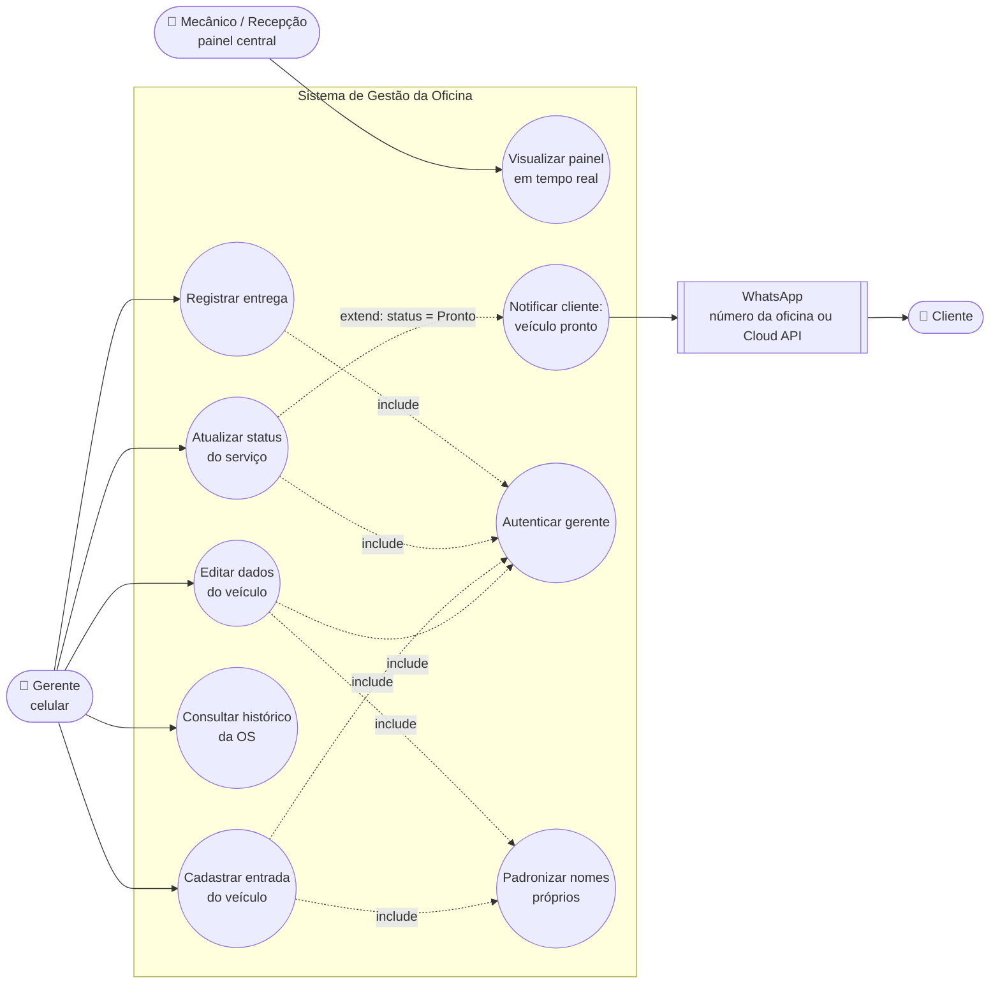
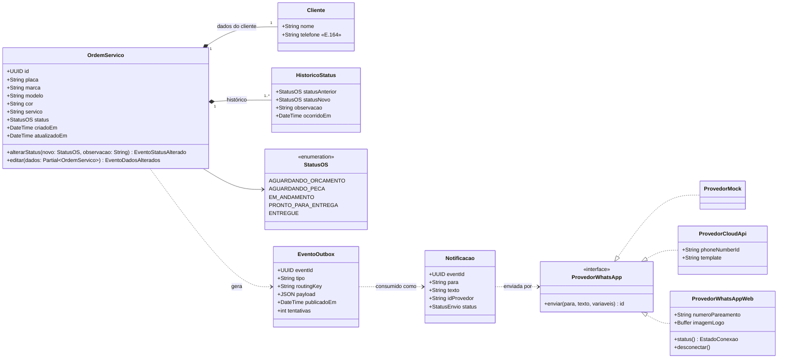
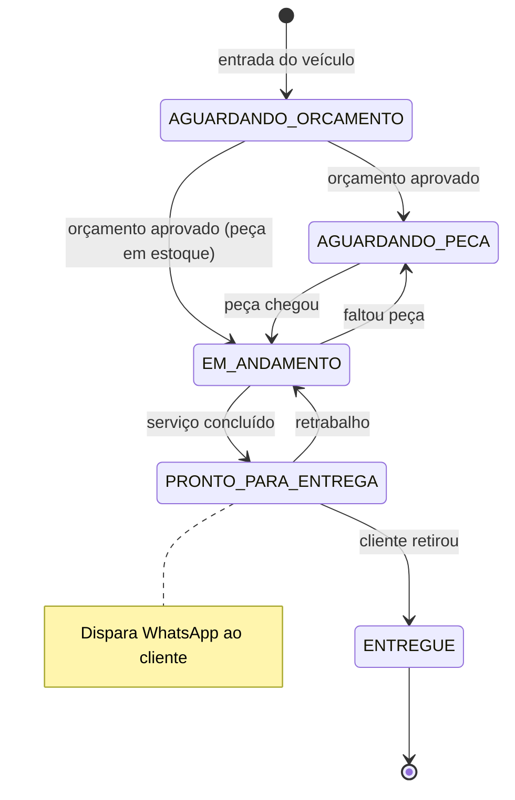
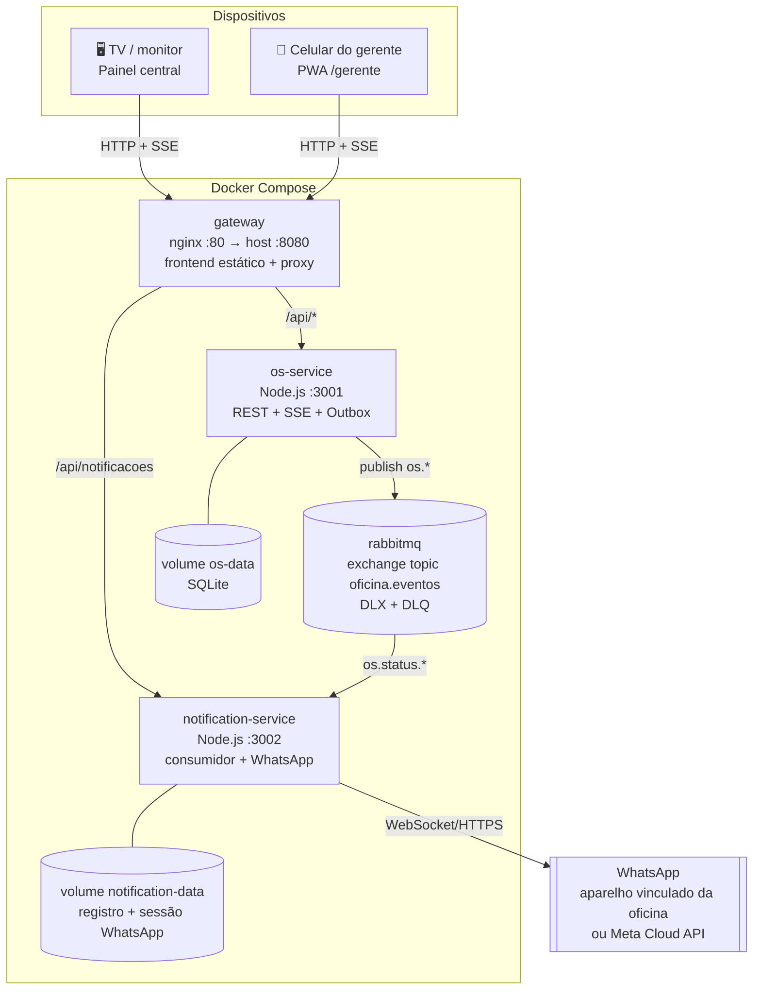

# Modelagem UML

Os diagramas usam [Mermaid](https://mermaid.js.org/), que o GitHub desenha direto na página.

## 1. Casos de uso



## 2. Diagrama de classes (domínio)



## 3. Máquina de estados do veículo



> Os quatro status do painel podem ir e voltar entre si (a oficina real tem idas e vindas).
> Só um veículo em `PRONTO_PARA_ENTREGA` pode ser `ENTREGUE`, e `ENTREGUE` é estado final.

## 4. Sequência: gerente marca "Pronto para Entrega"

```mermaid
sequenceDiagram
    autonumber
    actor G as Gerente (celular)
    participant GW as API Gateway (nginx)
    participant OS as os-service
    participant DB as SQLite (ordens + outbox)
    participant R as Relay do Outbox
    participant MQ as RabbitMQ
    participant NS as notification-service
    participant WA as WhatsApp (número da oficina)
    participant P as Painel central
    actor C as Cliente

    G->>GW: PATCH /api/ordens/{id}/status {PRONTO_PARA_ENTREGA}<br/>Authorization: Bearer token
    GW->>OS: proxy
    OS->>OS: valida token e transição
    OS->>DB: BEGIN; UPDATE ordens; INSERT historico; INSERT outbox; COMMIT
    OS-->>P: SSE "ordem_atualizada"
    P->>P: move o card para "Pronto para Entrega"
    OS-->>G: 200 OK (ordem atualizada)

    loop a cada 1s
        R->>DB: SELECT eventos pendentes
        R->>MQ: publish oficina.eventos<br/>routing key os.status.PRONTO_PARA_ENTREGA
        MQ-->>R: confirm
        R->>DB: marca como publicado
    end

    MQ->>NS: entrega (fila notificacoes.whatsapp)
    NS->>NS: idempotência (eventId), lista de permitidos e monta mensagem
    NS->>WA: onWhatsApp(número) + envia imagem com logo e legenda
    WA-->>NS: id da mensagem
    NS->>MQ: ack
    WA-->>C: imagem "Seu veículo está PRONTO!" + detalhes (veículo, placa, serviço, retirada)

    alt falha temporária (5xx, 429, rede)
        NS->>MQ: republica com x-tentativa+1 (backoff exponencial)
    else número sem WhatsApp ou tentativas esgotadas
        NS->>MQ: nack → DLX → notificacoes.whatsapp.dlq
    end
```

## 5. Componentes e implantação (Docker)


